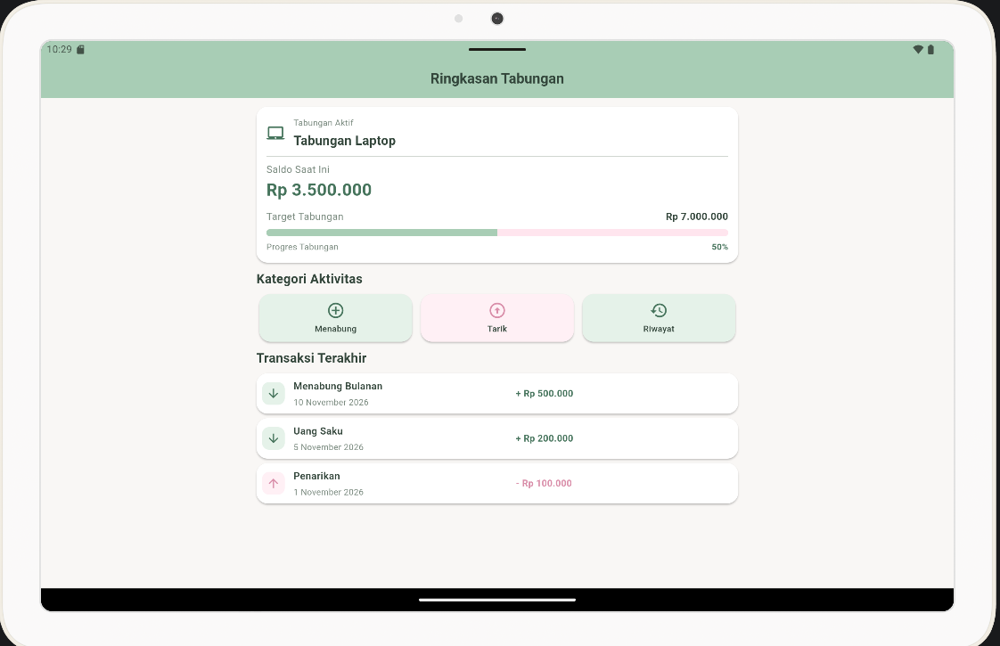

# TabungKu – Tugas Minggu 3 Pemrograman Mobile

## Identitas Mahasiswa

- **Nama:** Septiara Pratama
- **NIM:** 20240801027
- **Program Studi:** Teknik Informatika
- **Universitas:** Universitas Esa Unggul
- **Mata Kuliah:** Pemrograman Mobile
- **Tugas:** Minggu 3 – Menyusun Layout dengan Widget Dasar Flutter

## Deskripsi Aplikasi

TabungKu merupakan aplikasi sederhana berbasis Flutter yang dibuat untuk menampilkan ringkasan tabungan secara statis. Aplikasi ini menampilkan nama tabungan, saldo saat ini, target tabungan, progres tabungan, kategori aktivitas, dan riwayat transaksi.

Pembuatan aplikasi ini bertujuan untuk mempraktikkan penggunaan widget dasar Flutter dalam menyusun tampilan yang rapi, terstruktur, dan responsif pada layar HP maupun tablet.

## Fitur Aplikasi

1. **Ringkasan Tabungan**  
   Menampilkan informasi Tabungan Laptop dengan saldo Rp 3.500.000 dan target Rp 7.000.000.

2. **Progres Tabungan**  
   Menggunakan `LinearProgressIndicator` untuk menunjukkan progres tabungan sebesar 50%.

3. **Kategori Aktivitas**  
   Menampilkan tiga Card terpisah, yaitu Menabung, Tarik, dan Riwayat, yang dilengkapi ikon dan warna pastel.

4. **Transaksi Terakhir**  
   Menampilkan tiga transaksi dalam Card terpisah, yaitu:
    - Menabung Bulanan: + Rp 500.000
    - Uang Saku: + Rp 200.000
    - Penarikan: - Rp 100.000

5. **Tampilan Responsif**  
   Tampilan HP dan tablet menggunakan susunan satu kolom yang sama. Lebar konten dibatasi agar tetap proporsional, sedangkan ukuran Card, jarak, dan padding menyesuaikan tinggi layar tablet. Halaman menggunakan `ListView` agar seluruh bagian dapat diakses dengan scrolling apabila diperlukan.

## Widget Flutter yang Digunakan

| Widget | Fungsi |
|---|---|
| `MaterialApp` | Mengatur aplikasi dan tema utama. |
| `Scaffold` | Menyusun kerangka halaman aplikasi. |
| `AppBar` | Menampilkan judul Ringkasan Tabungan. |
| `Column` | Menyusun komponen secara vertikal. |
| `Row` | Menyusun komponen secara horizontal. |
| `Card` | Menampilkan informasi tabungan, kategori, dan transaksi dalam kartu terpisah. |
| `Container` | Mengatur latar dan dekorasi ikon transaksi. |
| `Padding` | Memberikan jarak di dalam komponen. |
| `SizedBox` | Mengatur jarak antarwidget. |
| `Expanded` | Membagi ruang pada susunan horizontal. |
| `Flexible` | Membantu teks nominal menyesuaikan ruang. |
| `ListView` | Membuat halaman dapat digulir. |
| `LayoutBuilder` | Menyesuaikan layout berdasarkan ukuran layar yang tersedia. |
| `ConstrainedBox` | Membatasi lebar maksimal konten pada HP dan tablet. |
| `Divider` | Memberikan pemisah pada informasi dalam Card tabungan. |
| `LinearProgressIndicator` | Menampilkan progres tabungan sebesar 50%. |
| `ClipRRect` | Membuat sudut indikator progres menjadi melengkung. |

## Responsivitas Tampilan

Aplikasi dirancang agar dapat digunakan pada HP dan tablet dengan tampilan yang konsisten.

Pada **HP**, komponen disusun secara vertikal dengan lebar konten maksimal 500 logical pixels dan padding yang sesuai dengan ukuran layar.

Pada **tablet**, susunan tetap satu kolom dengan lebar maksimal 700 logical pixels. Ketika tinggi area tampilan kurang dari 700 logical pixels, Card dan jarak antarbagian dibuat lebih ringkas agar penggunaan ruang lebih efisien.

Penggunaan `ListView` memungkinkan pengguna menggulir halaman untuk melihat seluruh informasi tanpa memaksakan semua komponen tampil sekaligus.

## Hasil Tampilan Aplikasi

### 1. Tampilan HP


### 2. Tampilan Tablet



## Teknologi yang Digunakan

- Flutter
- Bahasa pemrograman Dart
- Android Studio
- Material Design

Aplikasi menggunakan data statis dan tidak memerlukan database maupun package tambahan.

## Cara Menjalankan Aplikasi

1. Pastikan Flutter SDK dan Android Studio sudah terpasang.
2. Buka folder proyek `tabungku_layout` menggunakan Android Studio atau terminal.
3. Jalankan perintah berikut untuk mengambil dependensi:

   ```bash
   flutter pub get
   ```

4. Jalankan emulator Android atau hubungkan perangkat.
5. Jalankan aplikasi dengan perintah:

   ```bash
   flutter run
   ```

6. Aplikasi akan menampilkan halaman Ringkasan Tabungan.

## Struktur Proyek

```text
tabungku_layout/
├── lib/
│   └── main.dart
├── docs/
│   ├── layar_ponsel.png
│   └── layar_tablet.png
├── test/
├── pubspec.yaml
└── README.md
```

## Kesimpulan

Melalui pembuatan aplikasi TabungKu, saya dapat mempraktikkan penggunaan widget dasar Flutter seperti `Scaffold`, `Column`, `Row`, `Card`, `Container`, dan `ListView` untuk menyusun halaman ringkasan tabungan. Selain itu, saya juga mempelajari cara menyesuaikan tampilan pada HP dan tablet agar komponen tetap rapi, mudah dibaca, dan dapat diakses pada ukuran layar yang berbeda.