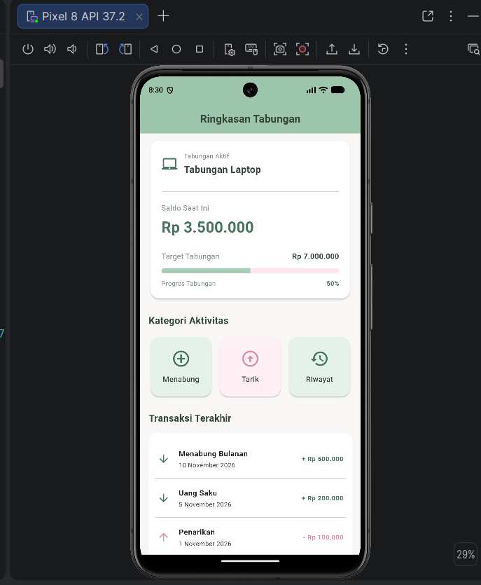

# TabungKu – Tugas Minggu 3 Pemrograman Mobile

## Deskripsi Proyek

**TabungKu** merupakan aplikasi sederhana berbasis Flutter yang dibuat untuk memenuhi **Tugas Minggu 3 Mata Kuliah T1505 Pemrograman Mobile**. Tugas ini berfokus pada penyusunan tata letak (*layout*) halaman Ringkasan Tabungan menggunakan widget dasar Flutter.

Aplikasi menampilkan informasi nama tabungan, saldo, target tabungan, kategori aktivitas, serta daftar transaksi menggunakan data statis (*hard-coded*).

Tampilan aplikasi menggunakan perpaduan warna **hijau sage dan pink pastel** agar terlihat sederhana, menarik, dan rapi. Layout dirancang agar dapat menyesuaikan ukuran layar HP maupun tablet.

## Identitas Mahasiswa

| Keterangan | Informasi |
|---|---|
| Nama | Septiara Pratama |
| NIM | 20240801027 |
| Universitas | Universitas Esa Unggul |
| Fakultas | Fakultas Ilmu Komputer |
| Program Studi | Teknik Informatika |
| Mata Kuliah | T1505 Pemrograman Mobile |
| Semester | 5 |
| Tugas | Minggu 3 – Menyusun Layout dengan Widget Dasar Flutter |

## Fitur Tampilan

1. **Ringkasan Tabungan** – Menampilkan nama tabungan, saldo saat ini, target tabungan, serta indikator progres pencapaian target.
2. **Kategori Aktivitas** – Menampilkan tiga kategori, yaitu Menabung, Tarik, dan Riwayat, menggunakan Card yang terpisah.
3. **Transaksi Terakhir** – Menampilkan tiga transaksi beserta judul, tanggal, dan nominal menggunakan data statis.
4. **Layout Responsif** – Menggunakan pengaturan lebar konten agar tampilan dapat menyesuaikan layar HP dan tablet.
5. **Tema Warna Pastel** – Menggunakan kombinasi warna hijau sage, pink pastel, dan putih.

> **Catatan:** Aplikasi masih berfokus pada tampilan antarmuka. Data transaksi bersifat statis dan kategori aktivitas belum memiliki fungsi interaktif.

## Widget Flutter yang Digunakan

| Widget | Fungsi |
|---|---|
| `MaterialApp` | Mengatur konfigurasi utama aplikasi dan tema. |
| `Scaffold` | Membuat struktur dasar halaman aplikasi. |
| `AppBar` | Menampilkan judul Ringkasan Tabungan. |
| `Card` | Menampilkan informasi tabungan dan kategori aktivitas. |
| `Column` | Menyusun elemen secara vertikal. |
| `Row` | Menyusun elemen secara horizontal. |
| `Container` | Mengatur tampilan dan batas lebar konten. |
| `Padding` | Memberikan jarak di dalam widget. |
| `SizedBox` | Mengatur jarak antarelemen. |
| `Text` dan `Icon` | Menampilkan informasi dan ikon. |
| `Expanded` dan `Flexible` | Menyesuaikan pembagian ruang pada layout. |
| `ListView` | Menyusun isi halaman secara vertikal dan memungkinkan halaman digulir. |
| `Divider` | Memberikan garis pemisah antarelemen. |
| `LinearProgressIndicator` | Menampilkan persentase pencapaian target tabungan. |
| `ClipRRect` | Membuat sudut indikator progres menjadi melengkung. |

Seluruh widget yang digunakan merupakan widget bawaan Flutter tanpa menggunakan package pihak ketiga.

## Teknologi yang Digunakan

- **Framework:** Flutter
- **Bahasa Pemrograman:** Dart
- **IDE:** Android Studio
- **Desain Antarmuka:** Material Design
- **Pengujian:** Android Emulator (HP dan Tablet)
- **Version Control:** Git dan GitHub

## Hasil Tampilan Aplikasi

Berikut merupakan dokumentasi tampilan aplikasi TabungKu pada dua ukuran layar berbeda.

### 1. Tampilan Mobile (HP)



*Tampilan aplikasi pada layar HP yang menampilkan ringkasan tabungan, kategori aktivitas, dan tiga transaksi terakhir.*

### 2. Tampilan Tablet


*Tampilan aplikasi pada layar tablet dengan ukuran konten yang disesuaikan agar tetap rapi dan mudah dibaca.*

## Cara Menjalankan Aplikasi

1. Pastikan Flutter SDK, Dart, dan Android Studio sudah terpasang.
2. Clone repositori GitHub atau unduh proyek.
3. Buka folder `tabungku_layout` menggunakan Android Studio.
4. Jalankan Android Emulator atau hubungkan perangkat Android.
5. Buka terminal pada folder utama proyek.
6. Jalankan perintah berikut:

```bash
flutter pub get
flutter run
```

Untuk memeriksa kode aplikasi, jalankan:

```bash
flutter analyze
```

Untuk menjalankan pengujian widget, gunakan:

```bash
flutter test
```

## Struktur Proyek

```text
tabungku_layout/
├── android/
├── ios/
├── lib/
│   └── main.dart
├── test/
├── docs/
│   ├── layar_ponsel.png
│   └── layar_tablet.png
├── pubspec.yaml
├── pubspec.lock
├── analysis_options.yaml
└── README.md
```

## Kesimpulan

Melalui Tugas Minggu 3 ini, saya mempraktikkan penggunaan widget dasar Flutter untuk membuat halaman Ringkasan Tabungan pada aplikasi TabungKu.

Penggunaan `Card`, `Column`, `Row`, `Container`, `Padding`, dan `SizedBox` membantu menyusun tampilan menjadi lebih terstruktur dan rapi. Selain itu, penggunaan `ListView`, `Expanded`, dan `Flexible` membantu menyesuaikan tampilan pada ukuran layar yang berbeda.

Data transaksi ditampilkan secara statis menggunakan fungsi `barisTransaksi()` yang disusun dengan widget `Row` dan `Column`, tanpa menggunakan database maupun package pihak ketiga.

Aplikasi menggunakan perpaduan warna hijau sage dan pink pastel agar tampilan lebih menarik dan nyaman dilihat.

---

**Tugas Individu – Pemrograman Mobile**

Universitas Esa Unggul | Teknik Informatika | Semester 5